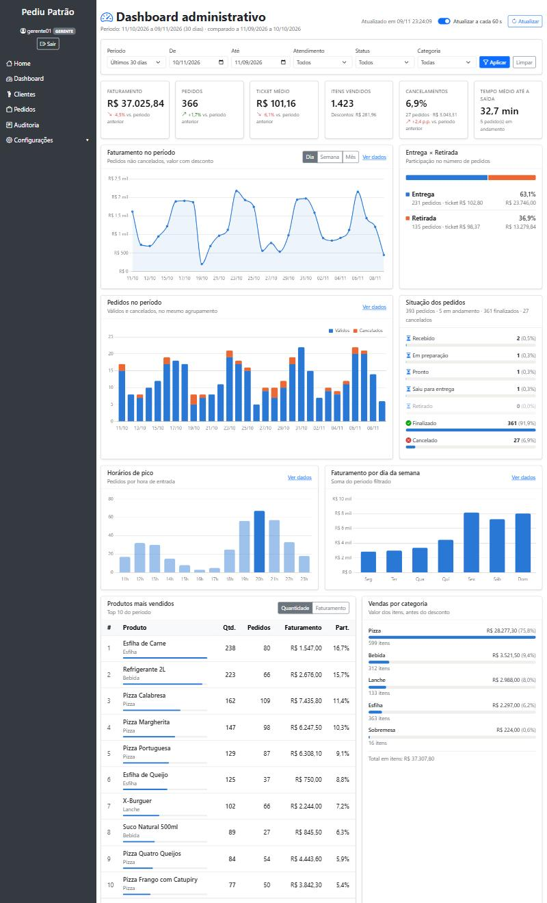
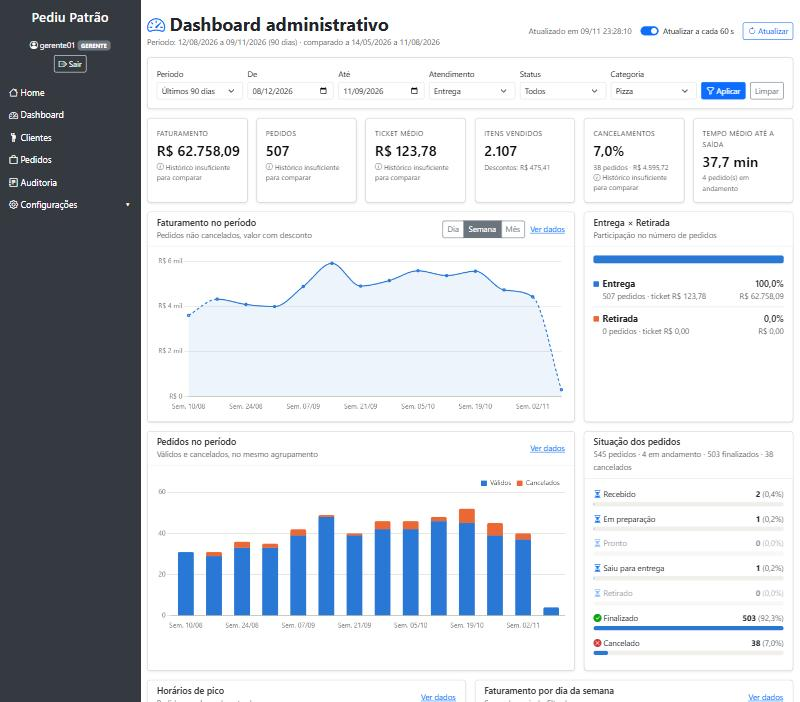

# Dashboard Administrativo — Pediu Patrão

Documento de entrega da atividade: análise de requisitos, projeto, documentação da API e evidências
de testes do Dashboard Administrativo integrado ao sistema de pedidos **Pediu Patrão**.

| Item | Onde está |
|---|---|
| Tela do dashboard | `GET /dashboard` — [`templates/dashboard.html`](../src/main/resources/templates/dashboard.html), [`static/js/dashboard.js`](../src/main/resources/static/js/dashboard.js) |
| API | `GET /api/dashboard/**` — [`DashboardController`](../src/main/java/com/umc/pediupatrao/controller/DashboardController.java) |
| Regras de cálculo | [`DashboardService`](../src/main/java/com/umc/pediupatrao/service/DashboardService.java) |
| Consulta ao MongoDB | [`DashboardRepository`](../src/main/java/com/umc/pediupatrao/repository/DashboardRepository.java) |
| Testes automatizados | [`DashboardServiceTest`](../src/test/java/com/umc/pediupatrao/service/DashboardServiceTest.java), [`DashboardApiTest`](../src/test/java/com/umc/pediupatrao/controller/DashboardApiTest.java) |
| Evidências | [`docs/evidencias/`](evidencias/) |
| Branch da implementação | `feature/dashboard-administrativo` → `develop` (gitflow) |

---

## 1. Contexto

O responsável pelo estabelecimento precisa acompanhar o desempenho das vendas sem abrir pedido por pedido.
O dashboard reúne, numa única tela, os indicadores do período, a evolução das vendas, a situação dos
pedidos em andamento e os produtos que mais vendem, com filtros para recortar a análise.

**Usuários:** `GERENTE` (responsável pela operação) e `ADMIN`. O `ATENDENTE` não acessa o painel —
ele opera os pedidos, não analisa o faturamento.

---

## 2. Requisitos funcionais

| ID | Requisito | Critérios de aceite | Implementação |
|---|---|---|---|
| **RF01** | Indicadores gerais de vendas | Exibir faturamento, nº de pedidos, ticket médio, itens vendidos, descontos concedidos, taxa e valor de cancelamento, pedidos em andamento e tempo médio até a saída; comparar com o período anterior de mesma duração. | `GET /api/dashboard/resumo` + 6 cartões de indicador com variação (▲/▼) |
| **RF02** | Análise de vendas (gráficos) | Evolução do faturamento e do nº de pedidos agrupada por dia, semana ou mês; horários de pico; faturamento por dia da semana; participação de entrega × retirada; vendas por categoria. | `vendas/evolucao`, `vendas/distribuicao`, `vendas/por-tipo-atendimento`, `vendas/por-categoria` + gráficos Chart.js |
| **RF03** | Situação dos pedidos | Quantidade e percentual de pedidos em cada status (todos os status, mesmo zerados); lista dos pedidos mais recentes destacando os que estão em andamento há mais de 40 min. | `pedidos/status`, `pedidos/recentes` |
| **RF04** | Produtos mais vendidos | Ranking (top N) por quantidade ou faturamento, com categoria, nº de pedidos e participação. | `produtos/mais-vendidos` |
| **RF05** | Filtros de consulta | Período (atalhos Hoje / 7 / 30 / 90 dias / Este mês ou datas livres), tipo de atendimento, status e categoria. Todos os blocos respeitam os mesmos filtros. | Parâmetros comuns em todos os endpoints + `GET /api/dashboard/filtros` para popular os campos |
| **RF06** | Integração com a API | A tela não recebe dados do servidor na renderização: tudo é obtido via `fetch` nos endpoints REST, autenticados pela sessão. | `dashboard.js` (função `api()`) |
| **RF07** | Atualização e tratamento de dados | Atualização manual e automática (60 s, pausada com a aba em segundo plano); horário da última atualização; estados de carregando, vazio e erro por bloco; validação de parâmetros com mensagens claras; tolerância a dados incompletos. | `geradoEm` em todas as respostas; tratamento descrito na seção 4 |

---

## 3. Requisitos não funcionais

| ID | Categoria | Requisito | Como foi atendido |
|---|---|---|---|
| RNF01 | Segurança | Somente `ADMIN` e `GERENTE` acessam a tela e a API. | `@PreAuthorize` na classe do controller e regra `/dashboard/**` no `SecurityConfig` (401 sem login, 403 por perfil). |
| RNF02 | Segurança | A API é somente leitura e não expõe dados sensíveis. | Só `GET`; respostas sem telefone/endereço de cliente; nomes escapados no front (proteção contra XSS). |
| RNF03 | Desempenho | Consultas filtradas no banco, sem varrer a coleção inteira. | Filtro de período/status/tipo/categoria aplicado no MongoDB; índices `idx_pedidos_data_entrada` e `idx_pedidos_status_data` criados na inicialização (`MongoInitConfig`). Período máximo de 366 dias por consulta. |
| RNF04 | Desempenho | O carregamento de um bloco não bloqueia os outros. | Os 8 blocos são carregados em paralelo e falham de forma isolada. |
| RNF05 | Confiabilidade | Valores monetários exatos. | `BigDecimal` (Decimal128 no MongoDB), 2 casas para dinheiro e 1 para percentuais, arredondamento `HALF_EVEN`. |
| RNF06 | Usabilidade | Interface responsiva e em português, com números no padrão brasileiro. | Bootstrap 5 (grid responsivo), `Intl.NumberFormat('pt-BR')` para R$, milhar e decimais. |
| RNF07 | Acessibilidade | Informação não pode depender só de cor. | Status com ícone + texto; atraso com ícone + rótulo "Atrasado"; legenda nos gráficos com 2 séries; botão "Ver dados" troca cada gráfico por uma tabela; paleta validada para daltonismo. |
| RNF08 | Manutenibilidade | Código testável e documentado. | Regras isoladas no `DashboardService` com `Clock` injetável; 27 testes novos (unitários e de API); este documento. |
| RNF09 | Interoperabilidade | Contrato REST previsível. | JSON, datas ISO-8601 (`yyyy-MM-dd` / `yyyy-MM-ddTHH:mm:ss`), erros no mesmo formato `StandardError` do restante do sistema. |

---

## 4. Regras de negócio e tratamento de dados

1. **Faturamento** = soma do `valorTotal` (já com desconto) dos pedidos **não cancelados**.
2. **Ticket médio** = faturamento ÷ pedidos válidos (não cancelados). Sem pedidos → `0,00`.
3. **Taxa de cancelamento** = cancelados ÷ total de pedidos do período × 100.
4. **Tempo médio até a saída** = média, em minutos, entre `dataHoraEntrada` e `dataHoraSaida` dos pedidos que já saíram. Sem saídas → `null` (a tela mostra "—").
5. **Período anterior** = mesmo número de dias, imediatamente antes de `dataInicio`. Variação = (atual − anterior) ÷ anterior × 100.
   Se o anterior for zero, a variação é `null` ("Sem base de comparação"). Se o período anterior começa **antes do primeiro pedido registrado**, `baseCompleta = false` e as variações vêm `null` — evita exibir crescimentos irreais como "+6.000%".
6. **Pedido em andamento** = status diferente de `FINALIZADO` e `CANCELADO`. É **atrasado** quando está em andamento há mais de **40 minutos**.
7. **Categoria** de um item: a categoria gravada no item no momento do pedido (`ItemPedido.categoria`); para pedidos antigos, sem esse campo, usa o tipo atual do produto; se nem isso existir, `"Sem categoria"`.
8. **Filtro de categoria**: considera os pedidos que têm ao menos um item da categoria. Nos indicadores de pedido (faturamento, ticket) o pedido entra inteiro; no ranking e na análise por categoria, apenas os itens da categoria.
9. **Vendas por categoria** e **ranking** usam o subtotal dos itens (antes do desconto do pedido), pois o desconto é aplicado sobre o pedido, não sobre o item.
10. **Evolução**: todos os dias/semanas/meses do intervalo são retornados, inclusive os sem venda (com zero), para o gráfico não "pular" datas. Semanas começam na segunda-feira. Semana ou mês que não cabe inteiro no período vem com `parcial = true` e é desenhado tracejado.
11. **Dados incompletos**: pedidos sem `dataHoraEntrada` são descartados (não há como posicioná-los no período); `valorTotal`, `valorDesconto` ou `itens` nulos contam como zero.

---

## 5. Modelagem e arquitetura

```mermaid
flowchart LR
    U[Navegador<br/>dashboard.html + dashboard.js] -- "fetch GET /api/dashboard/**<br/>(cookie de sessão)" --> C[DashboardController<br/>@PreAuthorize ADMIN/GERENTE]
    C --> S[DashboardService<br/>filtros, cálculos, comparativos]
    S --> R[DashboardRepository<br/>MongoTemplate + Criteria]
    S --> P[ProdutoRepository<br/>categorias]
    S --> CL[ClienteRepository<br/>nome do cliente]
    R --> DB[(MongoDB<br/>coleção pedidos)]
    P --> DB
    CL --> DB
```

**Fonte dos dados.** O dashboard lê a coleção `pedidos`, alimentada pelo fluxo de pedidos já existente
(criação, mudança de status, desconto e cancelamento). Nenhuma coleção nova foi necessária: os dados que
o painel precisa (datas de entrada/saída, status, tipo de atendimento, valores e itens) já estão no
documento do pedido.

**Alterações no modelo**

| Elemento | Alteração | Motivo |
|---|---|---|
| `ItemPedido.categoria` | Novo campo, preenchido com o `tipo` do produto ao registrar o pedido. | Assim como nome e preço, a categoria é uma "fotografia" do momento da venda: se o produto mudar de categoria depois, o histórico não muda. |
| Índice `idx_pedidos_data_entrada` | `{dataHoraEntrada: -1}` | Toda consulta do dashboard filtra por período. |
| Índice `idx_pedidos_status_data` | `{status: 1, dataHoraEntrada: -1}` | Filtro por status dentro do período. |

Documento `pedidos` (campos usados pelo dashboard):

```json
{
  "_id": "6af27fdebf81292326bb4f50",
  "clienteId": "6af27fdebf81292326bb4f46",
  "tipoAtendimento": "ENTREGA",
  "status": "FINALIZADO",
  "itens": [
    {"produtoId": "6af2...4f3c", "nomeProduto": "Pizza Calabresa", "categoria": "Pizza",
     "precoUnitario": 45.90, "quantidade": 2, "subtotal": 91.80}
  ],
  "subtotal": 91.80, "descontoPercentual": 10, "valorDesconto": 9.18, "valorTotal": 82.62,
  "dataHoraEntrada": "2026-11-08T20:12:00", "dataHoraSaida": "2026-11-08T20:47:00"
}
```

**Dados de demonstração.** Na inicialização, se não houver pedidos anteriores a ontem, o `DataInitializer`
gera 90 dias de histórico (≈1.100 pedidos, semente fixa) com mais movimento no fim de semana e no
jantar, ~7% de cancelamentos e ~10% de pedidos com desconto. Desative com
`pediupatrao.seed.historico=false`.

---

## 6. Documentação dos endpoints

**Base:** `http://localhost:8080/api/dashboard` · **Método:** sempre `GET` · **Formato:** JSON (UTF-8)
**Autenticação:** cookie de sessão obtido no login (`/login`). **Perfis:** `ADMIN`, `GERENTE`.

### 6.1 Parâmetros comuns (RF05)

Aceitos por todos os endpoints, exceto `/filtros`. Todos são opcionais.

| Parâmetro | Tipo | Padrão | Descrição |
|---|---|---|---|
| `dataInicio` | data `yyyy-MM-dd` | `dataFim` − 29 dias | Primeiro dia do período (inclusive). |
| `dataFim` | data `yyyy-MM-dd` | hoje | Último dia do período (inclusive). |
| `tipoAtendimento` | `ENTREGA` \| `RETIRADA` | todos | Filtra pelo tipo de atendimento. |
| `status` | `RECEBIDO` \| `EM_PREPARACAO` \| `PRONTO` \| `SAIU_PARA_ENTREGA` \| `RETIRADO` \| `FINALIZADO` \| `CANCELADO` | todos | Filtra pelo status atual do pedido. |
| `categoria` | texto | todas | Categoria do produto (valores em `/filtros`). Vazio = todas. |

Restrições: `dataInicio ≤ dataFim` e período de no máximo **366 dias**.

Todas as respostas (exceto `/filtros`) trazem `periodo` (`inicio`, `fim`, `dias`) — o período efetivamente
consultado, já com os valores padrão — e `geradoEm`, o momento do cálculo.

### 6.2 Respostas de erro

Todas no formato `StandardError`, o mesmo das demais APIs do sistema:

```json
{
  "timestamp": "2026-11-10T02:26:49.026444Z",
  "status": 400,
  "error": "Error",
  "message": "A data inicial não pode ser posterior à data final",
  "path": "/api/dashboard/resumo"
}
```

| HTTP | Quando | `message` |
|---|---|---|
| 400 | `dataInicio` posterior a `dataFim` | `A data inicial não pode ser posterior à data final` |
| 400 | Período maior que 366 dias | `O período consultado não pode ultrapassar 366 dias` |
| 400 | Data fora do formato | `Valor inválido para o parâmetro 'dataInicio': 09/11/2026. Use o formato yyyy-MM-dd` |
| 400 | Valor de enum inexistente (`status`, `tipoAtendimento`, `agrupamento`, `criterio`) | `Valor inválido para o parâmetro 'status': ENTREGUE. Valores aceitos: [RECEBIDO, ...]` |
| 400 | `limite` fora de 1–50 ou não numérico | `O limite deve estar entre 1 e 50` |
| 401 | Sem sessão (não logado) | corpo vazio |
| 403 | Perfil sem acesso (`ATENDENTE`) | `Acesso negado para o seu perfil` |

---

### 6.3 `GET /api/dashboard/filtros` — opções dos filtros (RF05)

Retorna as listas para montar os campos de filtro e o período padrão. Sem parâmetros.

```bash
curl -b cookies.txt http://localhost:8080/api/dashboard/filtros
```

```json
{
  "periodoPadrao": {"inicio": "2026-10-11", "fim": "2026-11-09", "dias": 30},
  "primeiroPedido": "2026-08-11",
  "ultimoPedido": "2026-11-09",
  "intervaloMaximoDias": 366,
  "status": [{"valor": "RECEBIDO", "descricao": "Recebido"}, {"valor": "EM_PREPARACAO", "descricao": "Em preparação"}, "..."],
  "tiposAtendimento": [{"valor": "ENTREGA", "descricao": "Entrega"}, {"valor": "RETIRADA", "descricao": "Retirada"}],
  "categorias": ["Bebida", "Esfiha", "Lanche", "Pizza", "Sobremesa"],
  "agrupamentos": ["DIA", "SEMANA", "MES"],
  "criteriosRanking": ["QUANTIDADE", "FATURAMENTO"]
}
```

Erros: 401, 403.

---

### 6.4 `GET /api/dashboard/resumo` — indicadores gerais (RF01)

Parâmetros: comuns (6.1).

```bash
curl -b cookies.txt "http://localhost:8080/api/dashboard/resumo?dataInicio=2026-10-01&dataFim=2026-10-31&tipoAtendimento=ENTREGA&categoria=Pizza"
```

```json
{
  "periodo": {"inicio": "2026-10-01", "fim": "2026-10-31", "dias": 31},
  "faturamento": 23394.99,
  "totalPedidos": 212,
  "pedidosValidos": 191,
  "ticketMedio": 122.49,
  "itensVendidos": 766,
  "totalDescontos": 205.31,
  "pedidosCancelados": 21,
  "taxaCancelamento": 9.9,
  "valorCancelado": 2545.51,
  "pedidosEmAndamento": 0,
  "tempoMedioAtendimentoMinutos": 38.7,
  "comparativo": {
    "periodoAnterior": {"inicio": "2026-08-31", "fim": "2026-09-30", "dias": 31},
    "baseCompleta": true,
    "faturamentoAnterior": 21428.73,
    "variacaoFaturamento": 9.2,
    "pedidosValidosAnterior": 173,
    "variacaoPedidos": 10.4,
    "ticketMedioAnterior": 123.87,
    "variacaoTicketMedio": -1.1,
    "taxaCancelamentoAnterior": 4.9
  },
  "geradoEm": "2026-11-09T23:26:48"
}
```

| Campo | Descrição |
|---|---|
| `faturamento` | Soma do valor com desconto dos pedidos não cancelados (R$). |
| `totalPedidos` / `pedidosValidos` | Todos os pedidos / pedidos não cancelados. |
| `ticketMedio` | `faturamento ÷ pedidosValidos`. |
| `itensVendidos` | Soma das quantidades dos itens dos pedidos válidos. |
| `totalDescontos` | Soma dos descontos concedidos nos pedidos válidos. |
| `taxaCancelamento` | % de pedidos cancelados. `valorCancelado`: valor que deixou de ser faturado. |
| `pedidosEmAndamento` | Pedidos ainda não finalizados nem cancelados. |
| `tempoMedioAtendimentoMinutos` | Média entrada → saída; `null` se nenhum pedido saiu. |
| `comparativo.variacao*` | Variação % sobre o período anterior; `null` sem base de comparação ou quando `baseCompleta = false`. |

Erros: 400 (parâmetros), 401, 403.

---

### 6.5 `GET /api/dashboard/vendas/evolucao` — evolução das vendas (RF02)

| Parâmetro | Tipo | Padrão | Descrição |
|---|---|---|---|
| comuns | — | — | Ver 6.1 |
| `agrupamento` | `DIA` \| `SEMANA` \| `MES` | `DIA` | Granularidade da série. |

```bash
curl -b cookies.txt "http://localhost:8080/api/dashboard/vendas/evolucao?agrupamento=SEMANA"
```

```json
{
  "periodo": {"inicio": "2026-10-11", "fim": "2026-11-09", "dias": 30},
  "agrupamento": "SEMANA",
  "pontos": [
    {"inicio": "2026-10-05", "rotulo": "Sem. 05/10", "parcial": true,  "pedidos": 15, "cancelados": 2, "faturamento": 1616.95, "ticketMedio": 107.80},
    {"inicio": "2026-10-12", "rotulo": "Sem. 12/10", "parcial": false, "pedidos": 89, "cancelados": 3, "faturamento": 9242.81, "ticketMedio": 103.85},
    "...",
    {"inicio": "2026-11-09", "rotulo": "Sem. 09/11", "parcial": true,  "pedidos": 6,  "cancelados": 0, "faturamento": 447.10,  "ticketMedio": 74.52}
  ],
  "geradoEm": "2026-11-09T23:26:48"
}
```

`pedidos` conta só os válidos; `cancelados` vem separado. Erros: 400 (inclusive `agrupamento` inválido), 401, 403.

---

### 6.6 `GET /api/dashboard/vendas/distribuicao` — horários de pico e dias da semana (RF02)

Parâmetros: comuns. Considera apenas pedidos não cancelados.

```bash
curl -b cookies.txt "http://localhost:8080/api/dashboard/vendas/distribuicao"
```

```json
{
  "periodo": {"inicio": "2026-10-11", "fim": "2026-11-09", "dias": 30},
  "porHora": [
    {"hora": 0, "rotulo": "00h", "pedidos": 0, "faturamento": 0.00},
    "...",
    {"hora": 20, "rotulo": "20h", "pedidos": 67, "faturamento": 7043.38},
    "..."
  ],
  "porDiaSemana": [
    {"diaSemana": "MONDAY", "rotulo": "Seg", "pedidos": 31, "faturamento": 2831.92, "ticketMedio": 91.35},
    "..."
  ],
  "geradoEm": "2026-11-09T23:26:48"
}
```

`porHora` sempre tem 24 posições (0–23) e `porDiaSemana` 7 (segunda a domingo). Erros: 400, 401, 403.

---

### 6.7 `GET /api/dashboard/vendas/por-categoria` — vendas por categoria (RF02)

Parâmetros: comuns. Valores dos itens, antes do desconto do pedido.

```bash
curl -b cookies.txt "http://localhost:8080/api/dashboard/vendas/por-categoria"
```

```json
{
  "periodo": {"inicio": "2026-10-11", "fim": "2026-11-09", "dias": 30},
  "faturamentoItens": 37307.80,
  "itens": [
    {"categoria": "Pizza",  "quantidade": 599, "faturamento": 28277.30, "participacao": 75.8},
    {"categoria": "Bebida", "quantidade": 312, "faturamento": 3521.50,  "participacao": 9.4},
    "..."
  ],
  "geradoEm": "2026-11-09T23:26:48"
}
```

Ordenado por faturamento (desc.). Erros: 400, 401, 403.

---

### 6.8 `GET /api/dashboard/vendas/por-tipo-atendimento` — entrega × retirada (RF02)

Parâmetros: comuns. Sempre retorna os dois tipos, mesmo zerados.

```bash
curl -b cookies.txt "http://localhost:8080/api/dashboard/vendas/por-tipo-atendimento"
```

```json
{
  "periodo": {"inicio": "2026-10-11", "fim": "2026-11-09", "dias": 30},
  "itens": [
    {"tipoAtendimento": "ENTREGA",  "descricao": "Entrega",  "pedidos": 231, "faturamento": 23746.00, "ticketMedio": 102.80, "participacao": 63.1},
    {"tipoAtendimento": "RETIRADA", "descricao": "Retirada", "pedidos": 135, "faturamento": 13279.84, "ticketMedio": 98.37,  "participacao": 36.9}
  ],
  "geradoEm": "2026-11-09T23:26:48"
}
```

`participacao` = % do número de pedidos válidos. Erros: 400, 401, 403.

---

### 6.9 `GET /api/dashboard/pedidos/status` — situação dos pedidos (RF03)

Parâmetros: comuns. Inclui cancelados. Todos os status aparecem, na ordem do fluxo.

```bash
curl -b cookies.txt "http://localhost:8080/api/dashboard/pedidos/status"
```

```json
{
  "periodo": {"inicio": "2026-10-11", "fim": "2026-11-09", "dias": 30},
  "total": 393,
  "emAndamento": 5,
  "finalizados": 361,
  "cancelados": 27,
  "itens": [
    {"status": "RECEBIDO", "descricao": "Recebido", "grupo": "EM_ANDAMENTO", "quantidade": 2, "percentual": 0.5, "valorTotal": 185.30},
    "...",
    {"status": "FINALIZADO", "descricao": "Finalizado", "grupo": "CONCLUIDO", "quantidade": 361, "percentual": 91.9, "valorTotal": 36663.74},
    {"status": "CANCELADO", "descricao": "Cancelado", "grupo": "CANCELADO", "quantidade": 27, "percentual": 6.9, "valorTotal": 3043.31}
  ],
  "geradoEm": "2026-11-09T23:26:48"
}
```

`grupo`: `EM_ANDAMENTO`, `CONCLUIDO` ou `CANCELADO`. Erros: 400, 401, 403.

---

### 6.10 `GET /api/dashboard/pedidos/recentes` — últimos pedidos (RF03)

| Parâmetro | Tipo | Padrão | Descrição |
|---|---|---|---|
| comuns | — | — | Ver 6.1 |
| `limite` | inteiro 1–50 | `10` | Quantidade de pedidos retornados. |

```bash
curl -b cookies.txt "http://localhost:8080/api/dashboard/pedidos/recentes?limite=5"
```

```json
{
  "periodo": {"inicio": "2026-10-11", "fim": "2026-11-09", "dias": 30},
  "limiteAtrasoMinutos": 40,
  "itens": [
    {"id": "6af27fdebf81292326bb4f50", "cliente": "João Souza", "tipoAtendimento": "ENTREGA",
     "status": "RECEBIDO", "statusDescricao": "Recebido", "quantidadeItens": 7, "valorTotal": 81.50,
     "dataHoraEntrada": "2026-11-09T23:18:22.117", "minutosEmAberto": 8, "atrasado": false},
    {"id": "6af27fdebf81292326bb4f53", "cliente": "Maria Silva", "tipoAtendimento": "ENTREGA",
     "status": "SAIU_PARA_ENTREGA", "statusDescricao": "Saiu para entrega", "quantidadeItens": 5, "valorTotal": 71.90,
     "dataHoraEntrada": "2026-11-09T22:37:22.117", "minutosEmAberto": 49, "atrasado": true}
  ],
  "geradoEm": "2026-11-09T23:26:48"
}
```

Ordenado do mais recente para o mais antigo. `minutosEmAberto` é `null` para pedidos finalizados/cancelados.
Cliente excluído aparece como `"Cliente não encontrado"`. Erros: 400 (inclusive `limite`), 401, 403.

---

### 6.11 `GET /api/dashboard/produtos/mais-vendidos` — ranking de produtos (RF04)

| Parâmetro | Tipo | Padrão | Descrição |
|---|---|---|---|
| comuns | — | — | Ver 6.1 |
| `limite` | inteiro 1–50 | `10` | Tamanho do ranking. |
| `criterio` | `QUANTIDADE` \| `FATURAMENTO` | `QUANTIDADE` | Ordenação (empate desempata pelo outro critério). |

```bash
curl -b cookies.txt "http://localhost:8080/api/dashboard/produtos/mais-vendidos?limite=5&criterio=FATURAMENTO"
```

```json
{
  "periodo": {"inicio": "2026-10-11", "fim": "2026-11-09", "dias": 30},
  "criterio": "FATURAMENTO",
  "totalItensVendidos": 1423,
  "itens": [
    {"posicao": 1, "produtoId": "6af27fdebf81292326bb4f3c", "nome": "Pizza Calabresa", "categoria": "Pizza",
     "quantidade": 162, "pedidos": 109, "faturamento": 7435.80, "participacao": 11.4},
    {"posicao": 2, "produtoId": "6af27fdebf81292326bb4f3e", "nome": "Pizza Portuguesa", "categoria": "Pizza",
     "quantidade": 129, "pedidos": 87, "faturamento": 6308.10, "participacao": 9.1},
    "..."
  ],
  "geradoEm": "2026-11-09T23:26:48"
}
```

`pedidos` = em quantos pedidos o produto apareceu; `participacao` = % da quantidade sobre `totalItensVendidos`.
Pedidos cancelados não entram. Erros: 400, 401, 403.

---

### 6.12 Testando pelo navegador

Logado como `gerente01`, no console (F12) da tela do dashboard:

```js
fetch('/api/dashboard/resumo?dataInicio=2026-11-01&dataFim=2026-11-09')
  .then(r => r.json()).then(console.log);
```

---

## 7. Evidências de testes

### 7.1 Testes automatizados — 58 testes, 0 falhas

Execução: `./mvnw test` (não precisa de MongoDB). Saída completa em
[`evidencias/testes-automatizados.txt`](evidencias/testes-automatizados.txt).

```
Tests run: 12, Failures: 0, Errors: 0 -- in controller.AutorizacaoApiTest
Tests run:  8, Failures: 0, Errors: 0 -- in controller.DashboardApiTest      (novo)
Tests run:  6, Failures: 0, Errors: 0 -- in entity.StatusPedidoTest
Tests run:  3, Failures: 0, Errors: 0 -- in service.ClienteServiceTest
Tests run: 19, Failures: 0, Errors: 0 -- in service.DashboardServiceTest     (novo)
Tests run: 10, Failures: 0, Errors: 0 -- in service.PedidoServiceTest
Tests run: 58, Failures: 0, Errors: 0, Skipped: 0 — BUILD SUCCESS
```

**`DashboardServiceTest`** (regras de cálculo; repositório simulado em memória, relógio fixo em 09/11/2026 21:00):

| Teste | O que comprova | RF |
|---|---|---|
| `filtroPadraoSaoOsUltimos30DiasAteHoje` | Período padrão e categoria em branco tratada como "todas". | RF05 |
| `filtroRejeitaDataInicialPosteriorAFinal` | Validação do período. | RF05/RF07 |
| `filtroRejeitaPeriodoMaiorQue366Dias` | Limite de 366 dias (366 exatos é aceito). | RF05/RNF03 |
| `periodoAnteriorTemAMesmaDuracao` | Cálculo do período de comparação. | RF01 |
| `resumoIgnoraCanceladosNoFaturamentoECalculaIndicadores` | Faturamento, ticket, itens, descontos, taxa de cancelamento, tempo médio e variações. | RF01 |
| `comparativoSemHistoricoSuficienteNaoCalculaVariacao` | `baseCompleta = false` e variações nulas sem histórico. | RF01/RF07 |
| `resumoSemPedidosRetornaZerosSemErro` | Período vazio não gera divisão por zero. | RF07 |
| `resumoToleraPedidosComDadosIncompletos` | Pedido sem data é descartado; valores nulos contam como zero. | RF07 |
| `variacaoPercentual` | Fórmula da variação e base zero. | RF01 |
| `evolucaoDiariaPreencheDiasSemVenda` | Dias sem venda aparecem zerados; cancelados separados. | RF02 |
| `evolucaoSemanalAgrupaPelaSegundaFeira` | Agrupamento semanal e marcação de semanas parciais. | RF02 |
| `distribuicaoPorHoraEDiaDaSemana` | 24 horas, dia da semana e exclusão de cancelados. | RF02 |
| `vendasPorCategoriaUsaCategoriaDoItemOuDoCadastro` | Categoria do item, fallback para o cadastro e filtro de categoria. | RF02/RF05 |
| `vendasPorTipoAtendimentoSempreTrazEntregaERetirada` | Participação e ticket por tipo. | RF02 |
| `statusTrazTodosOsStatusComPercentual` | Todos os status, percentuais e totais por grupo. | RF03 |
| `pedidosRecentesOrdenadosEComAtraso` | Ordenação, nome do cliente, atraso (> 40 min) e cliente inexistente. | RF03 |
| `limiteForaDoIntervaloEhRejeitado` | `limite` 0 e 51 rejeitados. | RF07 |
| `rankingPorQuantidadeEPorFaturamento` | Os dois critérios, nº de pedidos, participação e exclusão de cancelados. | RF04 |
| `rankingComFiltroDeCategoriaConsideraSoOsItensDaCategoria` | Ranking filtrado por categoria e critério padrão. | RF04/RF05 |

**`DashboardApiTest`** (camada HTTP com Spring Security real, `@WebMvcTest`):

| Teste | Resultado esperado |
|---|---|
| `semLoginRetorna401` | 401 sem sessão. |
| `atendenteNaoAcessaODashboard` | 403 na API (JSON) e na tela `/dashboard`. |
| `gerenteConsultaResumo` | 200, JSON no contrato documentado e repasse correto de todos os filtros. |
| `adminConsultaRankingComParametrosPadrao` | 200 com `limite=10` e `criterio=QUANTIDADE` padrão. |
| `dataEmFormatoInvalidoRetorna400` | 400 com orientação `yyyy-MM-dd`; serviço não é chamado. |
| `enumInvalidoRetorna400ComValoresAceitos` | 400 listando valores aceitos (`status`, `agrupamento`). |
| `periodoInvalidoRetorna400` | 400 no formato `StandardError`. |
| `limiteInvalidoRetorna400` | 400 para `limite=500` e `limite=dez`. |

### 7.2 Teste manual da API integrada ao MongoDB

Aplicação rodando com MongoDB 7 (Docker) e o histórico de demonstração. O script
[`evidencias/testar-api.sh`](evidencias/testar-api.sh) faz login com os três perfis, chama cada endpoint
e grava requisição, corpo e status em [`evidencias/api/`](evidencias/api/).

| # | Cenário | Usuário | Esperado | Obtido |
|---|---|---|:-:|:-:|
| 01 | `GET /filtros` | gerente01 | 200 | ✅ 200 |
| 02 | `GET /resumo` (padrão 30 dias) | gerente01 | 200 | ✅ 200 |
| 03 | `GET /resumo` com período, tipo e categoria | gerente01 | 200 | ✅ 200 |
| 04 | `GET /vendas/evolucao?agrupamento=SEMANA` | gerente01 | 200 | ✅ 200 |
| 05 | `GET /vendas/distribuicao` | gerente01 | 200 | ✅ 200 |
| 06 | `GET /vendas/por-categoria` | gerente01 | 200 | ✅ 200 |
| 07 | `GET /vendas/por-tipo-atendimento` | gerente01 | 200 | ✅ 200 |
| 08 | `GET /pedidos/status` | gerente01 | 200 | ✅ 200 |
| 09 | `GET /pedidos/recentes?limite=5` | gerente01 | 200 | ✅ 200 |
| 10 | `GET /produtos/mais-vendidos?criterio=FATURAMENTO` | admin | 200 | ✅ 200 |
| 11 | `GET /resumo` sem login | — | 401 | ✅ 401 |
| 12 | `GET /resumo` | atendente01 | 403 | ✅ 403 |
| 13 | `dataInicio` > `dataFim` | gerente01 | 400 | ✅ 400 |
| 14 | `dataInicio=09/11/2026` | gerente01 | 400 | ✅ 400 |
| 15 | `status=ENTREGUE` | gerente01 | 400 | ✅ 400 |
| 16 | `limite=100` | gerente01 | 400 | ✅ 400 |
| 17 | Período de 678 dias | gerente01 | 400 | ✅ 400 |

**Conferência cruzada dos números (período padrão, 30 dias):** `pedidos/status` informa 393 pedidos, sendo
27 cancelados → 366 válidos, o mesmo valor de `resumo.pedidosValidos`; `por-tipo-atendimento` soma
231 + 135 = 366; `por-tipo-atendimento` soma R$ 23.746,00 + R$ 13.279,84 = R$ 37.025,84 = `resumo.faturamento`;
`produtos/mais-vendidos.totalItensVendidos` = 1.423 = `resumo.itensVendidos`.

### 7.3 Teste da interface

| Cenário | Resultado |
|---|---|
| Login como `gerente01` e acesso a **Dashboard** pelo menu | Todos os blocos carregados com os dados do MongoDB — [print](evidencias/01-dashboard-visao-geral.jpg) |
| Filtro "Últimos 90 dias" + Entrega + Pizza + agrupamento semanal | Todos os blocos recalculados; indicadores mostram "Histórico insuficiente para comparar"; semanas parciais tracejadas — [print](evidencias/02-dashboard-filtros-aplicados.jpg) |
| "Ver dados" em um gráfico | Gráfico substituído pela tabela com os mesmos valores. |
| Ranking: Quantidade ↔ Faturamento | Apenas o bloco do ranking é recarregado, na nova ordenação. |
| Datas invertidas no filtro | Mensagem "A data inicial não pode ser posterior à data final", sem chamar a API. |
| Login como `atendente01` e acesso a `/dashboard` | Página 403 "Acesso negado"; o item Dashboard não aparece no menu. |
| Atualização automática | Sem nenhuma interação, "Atualizado em" passou de 23:31:18 para 23:32:15 (intervalo de 60 s). |





---

## 8. Fluxo de versionamento (gitflow)

```
main ─────────────────────────────────────────────── (versão entregue anteriormente)
  └─ develop ───────────────────────────●──────────── (integração)
       └─ feature/dashboard-administrativo ─●──●──┘    (implementação da API + tela + docs)
```

- `main`: versão estável (atividade anterior).
- `develop`: criada a partir da `main`; recebe as features concluídas.
- `feature/dashboard-administrativo`: implementação dos endpoints, integração com o MongoDB, tela,
  testes e documentação; integrada na `develop` com `merge --no-ff`.
- Próximo passo do fluxo: `release/x.y` a partir da `develop` → `main` (com tag) após a avaliação.

---

## 9. Como executar

Pré-requisitos: Java 21 e um MongoDB (Atlas ou local).

```bash
# MongoDB local via Docker (opcional)
docker run -d --name pediupatrao-mongo -p 27017:27017 mongo:7
```

`.env` na raiz do projeto:

```properties
MONGODB_URI=mongodb://localhost:27017
MONGODB_DATABASE=pizzaria_dashboard
```

```bash
./mvnw spring-boot:run            # Linux/macOS
mvnw.cmd spring-boot:run          # Windows
```

Acesse `http://localhost:8080`, entre com `gerente01` / `teste123` e clique em **Dashboard**.

Testes: `./mvnw test`. Evidências da API (com a aplicação rodando): `bash docs/evidencias/testar-api.sh`.
